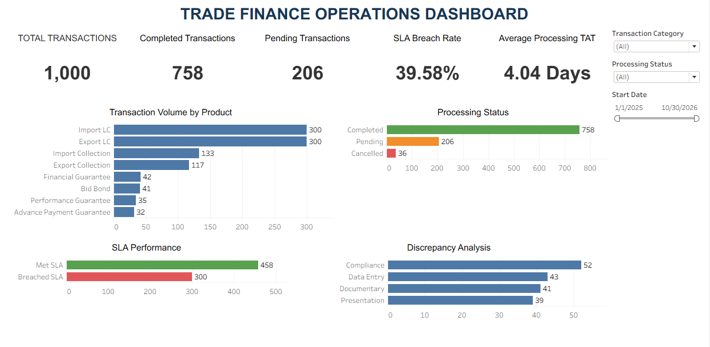

# Trade Finance Operations Dashboard | Tableau

## Project Overview

This project presents an interactive Tableau dashboard developed to analyze trade finance operational performance using a simulated dataset of 1,000 transactions.

The dashboard provides insights into transaction volumes, processing status, SLA performance, average processing turnaround time (TAT), product distribution and discrepancy categories.

## Business Objective

The objective of this project is to monitor trade finance operations, identify SLA breaches, understand transaction processing trends and highlight operational areas that may require further investigation.

## Tools Used

- Tableau
- Excel
- Data Analysis
- Data Visualization
- KPI Reporting
- Operational Performance Analysis

## Key Performance Indicators (KPIs)

- Total Transactions: 1,000
- Completed Transactions: 758
- Pending Transactions: 206
- SLA Breach Rate: 39.58%
- Average Processing TAT: 4.04 Days

## Dashboard Analysis

### 1. Transaction Volume by Product

Analyzes transaction volumes across different trade finance products, including Import LC, Export LC, Collections, Financial Guarantees, Bid Bonds and Performance Guarantees.

### 2. Processing Status

Provides an overview of transactions classified as Completed, Pending and Cancelled.

### 3. SLA Performance

Evaluates completed transactions against their agreed SLA.

- Transactions meeting SLA: 458
- Transactions breaching SLA: 300
- SLA Achievement: 60.42%
- SLA Breach Rate: 39.58%

### 4. Discrepancy Analysis

Highlights discrepancy categories identified in the dataset:

- Compliance: 52
- Data Entry: 43
- Documentary: 41
- Presentation: 39

## Key Business Insights

- 39.58% of completed transactions breached their SLA, indicating an opportunity to improve processing efficiency and SLA monitoring.
- 60.42% of completed transactions met their agreed SLA.
- Import LC and Export LC represent the highest transaction volumes among the analyzed product categories.
- Compliance discrepancies recorded the highest count among the discrepancy categories analyzed.

## Business Recommendations

- Investigate the causes of SLA breaches and identify operational bottlenecks.
- Strengthen SLA monitoring and exception tracking.
- Review high-volume products to identify opportunities for process optimization.
- Conduct focused reviews of compliance-related discrepancies.
- Improve operational quality controls to reduce recurring discrepancies.

## Dashboard Preview

## Project Files

- Tableau Workbook: Trade_Finance_Operations_Dashboard.twbx
- Dashboard Screenshot: Tableau_Trade_Finance_Dashboard.PNG

## Disclaimer

This project uses simulated data and is intended for portfolio and learning purposes only. It does not contain actual bank, customer or confidential information.
